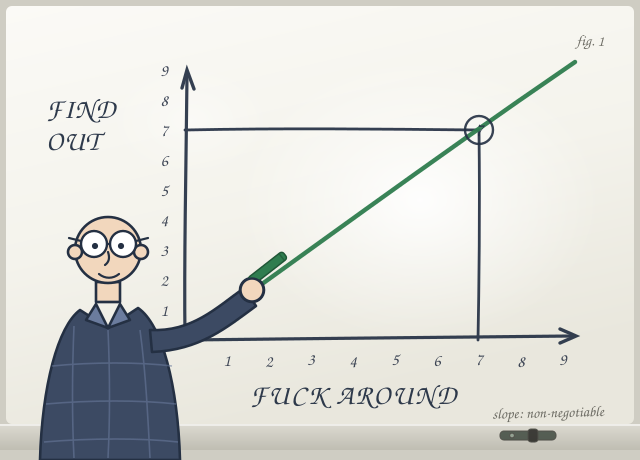

<div align="center">
  
</div>

```console
$ cat now.txt
role     AI Engineer @ EY GDS
focus    multi-agent orchestration · document intelligence · LLM evaluation
status   open to AI engineering roles
```

*just a person on the internet trying things and seeing what happens.*

<div align="center">
  
</div>

<div align="center">
  
</div>

## 01 · Stack

**Languages & backend**

   

**Agents & LLMOps**

    

**LLM platforms**

   

**Retrieval**

    

**Data platforms**

     

**Cloud & delivery**

     

<div align="center">
  
</div>

## 02 · Numbers

<div align="center">
  
  
</div>

<div align="center">
  
  <br />
  
  <br />
  <sub>YOLO · Pull Shark, both acquired by accident. nothing here is load-bearing.</sub>
</div>
